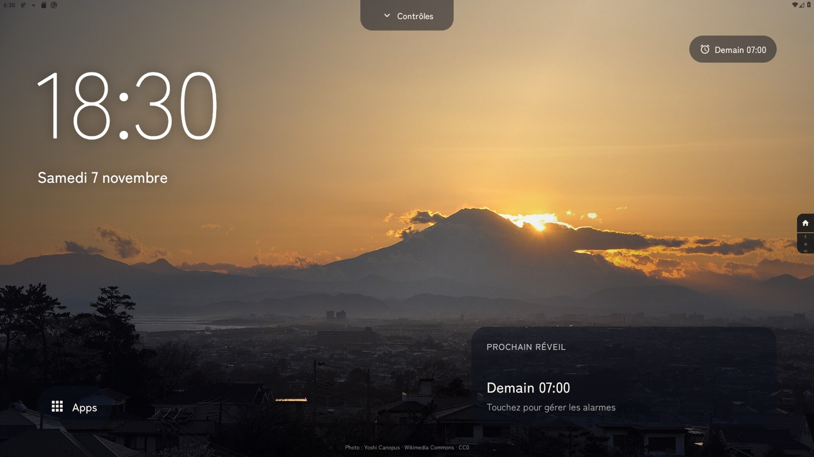
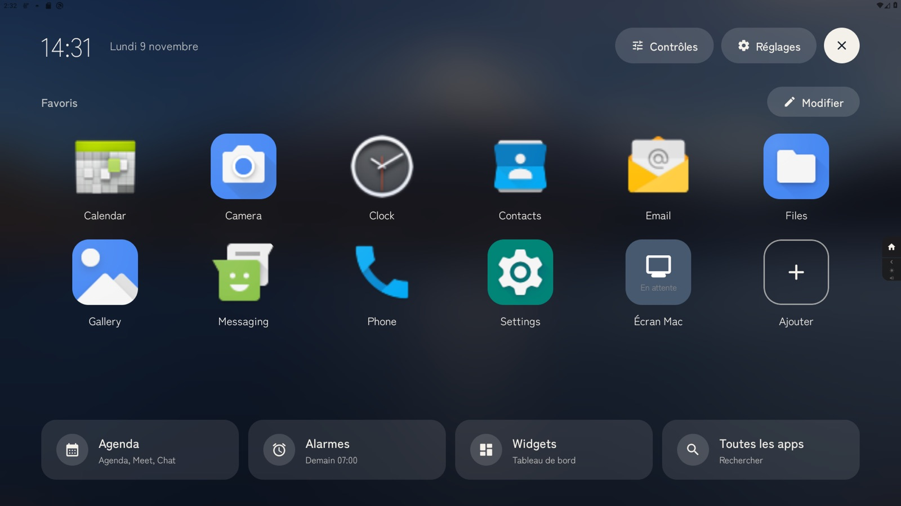
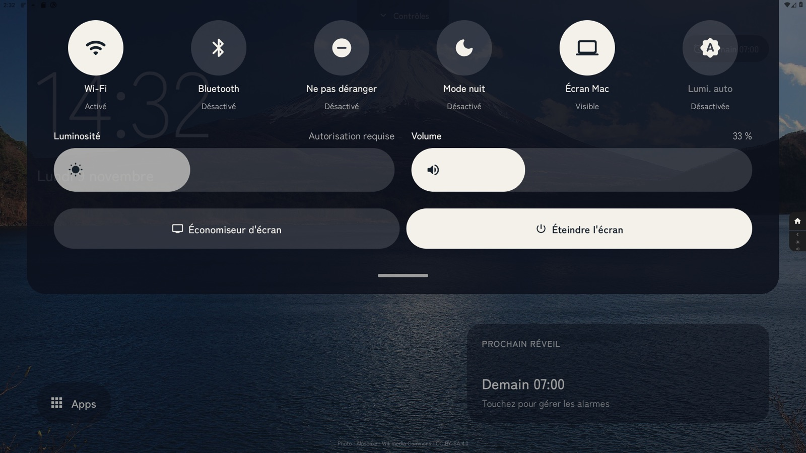
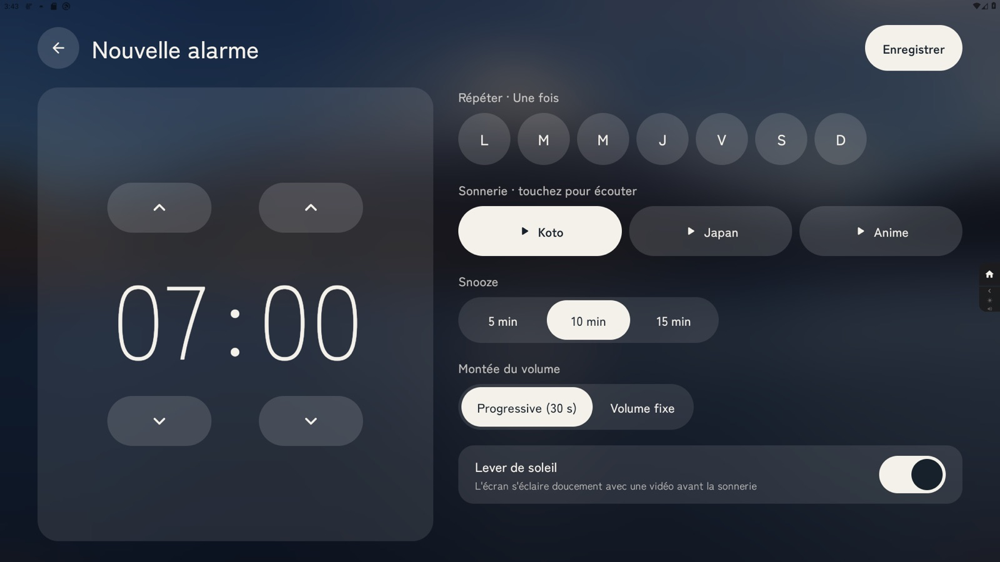
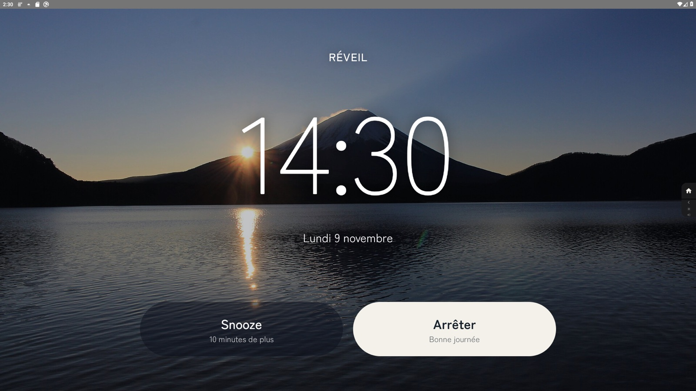

<div align="center">

# 復活 Fukkatsu No P

**Launcher maison pour Meta Portal — Portal Plus, Portal Go et Portal Mini**

*Encre japonaise · Ambiant permanent · Sans Google Services*

---

[](https://github.com/cyprienbrisset/fukkatsu-nop)
[](https://github.com/cyprienbrisset/fukkatsu-nop)
[](https://github.com/cyprienbrisset/fukkatsu-nop)
[](LICENSE)

</div>

---

**復活** (*fukkatsu no p*, « renaissance ») transforme un Meta Portal en hub maison permanent. Testé sur le **Portal Plus 1ère génération** (Android 9, API 28), le **Portal 2ème génération** (Android 10, API 29), le **Portal Go** et le **Portal Mini** (1280×800 dp, mode compact automatique). Depuis la version 1.1, l'interface est pensée pour le tactile et la distance : un écran ambiant plein écran sur une photo du mont Fuji qui change avec l'heure, et tout le reste à portée de doigt.



---

## Ce que vous voyez au quotidien

**L'écran ambiant** occupe tout l'écran : une photo du mont Fuji qui change à l'aube, en journée, au soir et la nuit, l'heure en très grand, la date et la météo. Touchez la météo pour passer à la ville suivante. Une carte en bas à droite tourne toutes les 12 secondes, à la manière de l'Echo Show : prochaine réunion Google Meet avec un bouton « Rejoindre », musique en cours avec sa pochette et ses commandes (Spotify, AirPlay et toute appli qui publie une session média), prochain réveil.

**Les apps** apparaissent dès qu'on touche l'écran (ou avec le bouton « Apps ») : favoris en icônes de 140 dp sur la photo floutée, badges de notifications, contacts récents Messenger et WhatsApp, et quatre raccourcis — Agenda, Alarmes, Widgets, Toutes les apps. La rangée **Apps ouvertes** liste les apps laissées en mémoire : un toucher pour y revenir, une croix pour la fermer, ou « Tout fermer ».

**Le centre de contrôle** descend du haut de l'écran : Wi-Fi, Bluetooth, Ne pas déranger, mode nuit, Écran Mac, luminosité automatique, curseurs épais de luminosité et de volume, économiseur et extinction de l'écran.

Après trois minutes sans contact, la luminosité baisse doucement ; un toucher la rétablit.

| | |
|---|---|
|  |  |

---

## Écran Mac (AirPlay)

Le Portal sert de récepteur AirPlay pour un Mac : Centre de contrôle → Recopie de l'écran → choisir le Portal. Recopie de l'écran en H.264 jusqu'à 60 images par seconde (testée avec macOS 27 ; même protocole qu'UxPlay, compatible de macOS 12 Monterey à macOS 27). Le mode « écran séparé » est expérimental.

Depuis la 2.1, le Portal est aussi une enceinte AirPlay : dans Apple Music (iPhone ou Mac), choisissez le Portal comme sortie, le son sort du Portal, avec le volume et la pause de l'iPhone. Fukkatsu décode l'ALAC (Apple Lossless) avec son propre décodeur, porté de la référence Apple, et l'AAC avec celui d'Android. Depuis la 2.3, la carte « En lecture » de l'accueil affiche le titre, l'artiste et (depuis la 2.4) la pochette envoyés par l'iPhone, et ses boutons lecture/pause, précédent et suivant commandent l'iPhone (DACP). La négociation suit celle d'[UxPlay](https://github.com/FDH2/UxPlay), dont le déchiffrement FairPlay (`playfair`, GPL-3.0) est compilé en bibliothèque native.

---

## Gestes

Rien n'est caché : chaque action a un bouton visible d'au moins 64 dp. Les gestes restent disponibles en raccourci.

| Geste | Effet |
|---|---|
| **Toucher** l'écran ambiant | Afficher les apps |
| **Glisser depuis le haut** | Ouvrir le centre de contrôle, dès le bord de l'écran (la barre système est masquée sur l'accueil et réapparaît au glisser) |
| **Glisser depuis le bas** | Afficher les apps |
| **Glisser verticalement à gauche** | Régler la luminosité (comme sur Netflix) |
| **Glisser verticalement à droite** | Régler le volume |
| **Appui long** sur une app favorite | Déplacer, retirer, réorganiser |
| **Appui long** dans « Toutes les apps » | Ajouter l'app aux favoris |

---

## Intégration Google — Agenda & Meet

Un troisième écran (glisser vers la droite depuis l'accueil) connecte le Portal à votre compte Google via le **Device Authorization Flow** — un code s'affiche sur le Portal, vous l'approuvez depuis n'importe quel autre appareil, zéro navigateur requis sur le Portal :

- **Agenda** : événements des 60 prochains jours, groupés par jour, indicateur vermillon pour les réunions imminentes (< 1 h). Créez un événement directement depuis le Portal via le bouton « + ».
- **Meet** : réunions Google Meet des 48 prochaines heures avec compte à rebours en direct et bouton « Rejoindre ».

Scope limité à `calendar` (lecture/écriture). Aucune dépendance Gmail. Tokens stockés localement via DataStore.

---

## Portal Go &amp; Mini

L'interface est dessinée pour les 1920 dp du Portal Plus. Sur les écrans plus étroits (Portal Go 10,1" et Portal Mini 8", 1280 dp), elle est réduite proportionnellement : même disposition, mêmes proportions, aucune configuration.
---

## Surveillance firmware

Un `AlarmManager` vérifie quotidiennement `android.os.Build.DISPLAY`. Si la valeur change (mise à jour OTA Meta), une notification haute priorité alerte immédiatement — permettant de vérifier que l'ADB et les overlays système restent fonctionnels après la mise à jour. La version courante du firmware est visible dans **Réglages → Surveillance firmware**.

---

## Le mont Fuji selon l'heure

| Moment | Heures | Photo |
|---|---|---|
| Aube | 5 h – 8 h | Lever de soleil au lac Motosu — Alpsdake, CC BY-SA 4.0 |
| Jour | 8 h – 17 h | Le Fuji depuis le lac Motosu — Alpsdake, CC BY-SA 4.0 |
| Soir | 17 h – 20 h | Coucher de soleil depuis Fujimisaka — Yoshi Canopus, CC0 |
| Nuit | 20 h – 5 h | *Fuji Under Polaris* — Victor Porof, CC BY-SA 3.0 |

Les écrans de contenu (réglages, alarmes, agenda…) reposent sur la photo du moment floutée, avec des surfaces en verre et la police japonaise **Zen Kaku Gothic New**. Le crédit de la photo affichée est visible en bas de l'écran ambiant.

---

## Résilience réseau

Les données météo et l'agenda Google sont mis en cache localement (Room) pour fonctionner sans connexion :

| Source | TTL cache |
|---|---|
| Météo (Open-Meteo) | 15 minutes |
| Agenda Google | 30 minutes |

Toutes les requêtes HTTP passent par un `RetryInterceptor` OkHttp avec backoff exponentiel (1 s → 2 s → 4 s, 3 tentatives maximum, codes 5xx uniquement).

---

## Commandes vocales locales — sans cloud

Le micro-réseau du Portal est réactivé via **Vosk**, moteur de reconnaissance 100% embarqué (zéro cloud, zéro GMS) :

- Dites **« Portal »** — le wake word est détecté localement en continu, aucun bouton requis
- **Commandes** : `ouvre [nom app]`, `mode nuit`, `mode jour`, `éteins l'écran`, `météo`, `alarme`
- Retour visuel : bannière en bas de l'écran pendant la fenêtre d'écoute (5 s)
- Modèle `vosk-model-small-fr-0.22` (~40 MB), téléchargé à la première activation depuis **Réglages → Commandes vocales** — une barre de progression linéaire affiche l'avancement en temps réel

---

## FukkaStore — installer des apps sans Google Play

Le Portal n'a pas de Play Store. FukkaStore comble ce manque : connectez votre compte Google une seule fois, puis parcourez et installez des applications directement depuis le catalogue officiel Google Play.

- Navigation par catégories (Productivité, Musique, Réseaux sociaux…)
- Recherche en texte libre
- Tap sur une app pour afficher sa fiche complète (description, captures d'écran, note)
- Une seule pression pour télécharger et installer
- Filtre automatique des apps incompatibles avec le Portal
- Filtre ABI automatique : seuls les splits compatibles avec le processeur de l'appareil sont installés
- **Portal 1ère génération** : installation silencieuse via AccessibilityService (l'interface système du Portal masque la fenêtre de confirmation standard). Depuis la 2.2, les mises à jour de Fukkatsu lui-même passent aussi par ce service : il appuie sur « Installer » puis « OK » sur l'écran d'installation, dessiné tout blanc sur ce modèle
- **Avertissement GMS** : les apps nécessitant exclusivement les Google Mobile Services sont signalées — elles peuvent ne pas fonctionner sur le Portal

---

## Mode nuit

Le mode nuit (assombrissement système du Portal) se bascule depuis le centre de contrôle ou automatiquement à l'heure configurée dans **Réglages → Affichage → Mode nuit automatique** (AlarmManager, survit aux redémarrages).

---

## Réveil intégré

Un gestionnaire de réveils pensé pour le matin : l'heure se règle avec de gros boutons ▲/▼, les jours en ronds de 100 dp, trois sonneries japonaises à écouter d'un toucher (Koto, Japan, Anime), snooze de 5, 10 ou 15 minutes, montée progressive du volume et **lever de soleil** — l'écran s'éclaire doucement avec une vidéo avant la sonnerie. À l'heure dite, l'écran de réveil affiche l'heure en très grand sur l'aube au lac Motosu, avec deux boutons de 150 dp : Snooze et Arrêter.

| | |
|---|---|
|  |  |

---

## Fiabilité

Un **watchdog** de crash est intégré : si l'app plante, un `AlarmManager` déclenche un redémarrage automatique dans la seconde — sans dialogue « Appli arrêtée », sans délai système.

---

## Splash screen

Au démarrage, un **hanko seal 復** s'anime en rouge vermillon sur fond Sumi — fondu entrant, maintien, fondu sortant. Aucun écran blanc interstitiel.

---

## Installation rapide

Le Portal doit avoir le **débogage USB** activé. Branchez-le et lancez :

```bash
bash scripts/provision-portal.sh --set-launcher
```

Ce script construit l'APK si besoin, l'installe, et accorde automatiquement toutes les permissions requises via ADB :

| Permission | Rôle |
|---|---|
| `WRITE_SECURE_SETTINGS` | Mode nuit système + AccessibilityService d'auto-install |
| `WRITE_SETTINGS` (appops) | Contrôle de la luminosité |
| Notification Policy | Accès Ne Pas Déranger |
| Device Admin | Extinction de l'écran |
| `BLUETOOTH_CONNECT` | Noms et liste des appareils Bluetooth jumelés |
| Verifier désactivé | Empêche les blocages d'installation Play Protect (pas de GMS) |

Voir `docs/technical.md` pour le détail technique complet.

---

## Développement

```bash
# Build + install + relance (device connecté)
./gradlew deployDebug
```

Nécessite Android Studio (JDK intégré) — pas de `java` global requis.

---

## Licence

GPL-3.0 — Copyright © 2024–2026 Cyprien Brisset

Depuis la version 1.1.35, Fukkatsu est distribué sous licence GNU GPL v3 (texte complet dans [LICENSE](LICENSE)). La recopie d'écran du Mac utilise le déchiffrement FairPlay `playfair` d'[UxPlay](https://github.com/FDH2/UxPlay) (GPL-3.0), inclus dans `app/src/main/cpp/playfair/`. Les versions antérieures à la 1.1.35 restent disponibles sous licence MIT.
